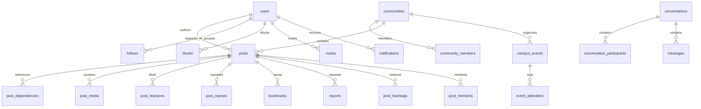
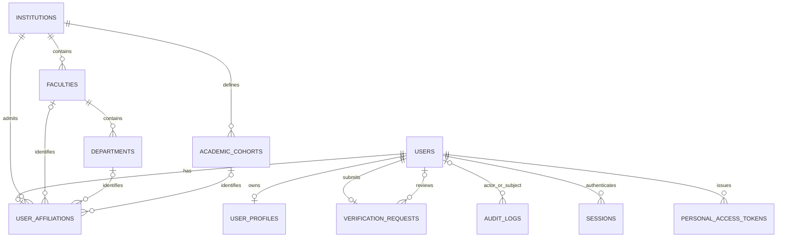

# Database

Additional additive migrations implement the social and campus domains. No existing database was reset. Post visibility includes institution, verified author, audience, private follows, blocks, active community membership and transitive source dependencies. Notification reference columns permit the same checks before cursor pagination and unread counts.

Implemented migrations include Laravel users/password reset/session, cache, jobs, Sanctum tokens, and `2026_10_15_000001_create_identity_domain`. PostgreSQL is authoritative. SQLite memory is an additional isolated test target.

Database uniqueness protects email, username, institution slug, per-institution faculty/cohort names, per-faculty department names, and one profile/affiliation/verification request per user. Foreign keys protect relationships; verification states/roles use constrained enum columns. Academic membership hierarchy is additionally validated on onboarding. Username is nullable for Laravel factories/bootstrap compatibility; registration requires it.

Affiliation is locked after submission to prevent swapping institution after verification. Manual review locks the request/user in a database transaction and writes the decision plus audit log. Roles are distinct from faculty/department/cohort. Uploaded identity documents and student IDs are not collected.

Profile images are private files referenced by opaque UUID paths, served only through authenticated authorization checks. Replacing an image deletes the old file after the profile update. Full account deletion/retention policy is a later production-readiness task; no account-deletion endpoint is currently implemented. Additive social-core and campus migrations add posts/media/ancestry, graph/interactions/reports/feed snapshots, communities/members, events/RSVP, conversations/messages, notifications and hashtag/mention indexes.
